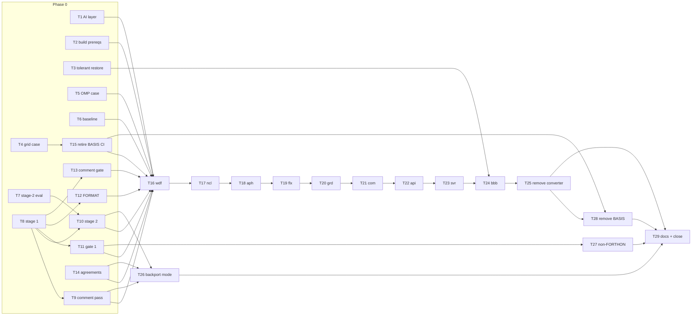

# Spec: AIUE-5 - Switch to pure Fortran build

> **Source of truth:** PRD [page 950273](https://holm10uedge.atlassian.net/wiki/spaces/SD/pages/950273) (revision 7,
> adversarial review APPROVE round 6), copy at `docs/prds/AIUE-5-switch-to-pure-fortran-build.md`.
> **Jira epic:** [AIUE-5](https://holm10uedge.atlassian.net/browse/AIUE-5) · **Generated by:** `/spec AIUE-5` on 2026-10-14.
> Section references (§) point into the PRD.

## Epic summary

Replace each of the 50 compiled MPPL `*.m` files with a committed free-form `.F90` produced by a pinned two-stage tool
(unmodified MPPL converter → fixed-form reference → fixed→free converter). Then remove the converter, PETSc, PACT and
BASIS. Three machine gates prove it: the same parsed program in serial and OpenMP builds, exact `fnrm` and residuals,
and no lost comment information. The Python API and default results do not change.

## Tickets

Keys are the Jira issues filed under AIUE-5. All product tickets get their own branch and worktree (with their own
venv), based on `v9-develop`, and land one by one by rebase-merge. Nothing is stacked: every freeze reference is
regenerated from the **parent commit on `v9-develop`** (§6.2), so each freeze PR must start from a `v9-develop` that
already contains its predecessor.

Confluence view: [Spec: AIUE-5 - Switch to pure Fortran build - Ticket Breakdown](https://holm10uedge.atlassian.net/wiki/spaces/SD/pages/1179649)
(child of the PRD page).

| # | Key | Title | Depends on | Wave |
|---|---|---|---|---|
| T1 | AIUE-17 | AI layer: move code facts out of skills and agents | — | 1 |
| T2 | AIUE-18 | Build prerequisites: drop PETSc/PACT build paths, fix nclpydep, stale-.F guard, delete dead .m | — | 1 |
| T3 | AIUE-19 | Tolerant hdf5_restore_dump | — | 1 |
| T4 | AIUE-20 | Grid-generation regression case and CI test-branch fix | — | 1 |
| T5 | AIUE-21 | OpenMP determinism regression case | — | 1 |
| T6 | AIUE-22 | Numeric baseline tool (gate 2) | — | 1 |
| T7 | AIUE-23 | Stage-2 converter evaluation and Phase 0 scans (spike) | — | 1 |
| T8 | AIUE-24 | Freeze tool stage 1: lexer and fixed-form reference | — | 1 |
| T14 | AIUE-30 | Stakeholder agreements and .m code-freeze announcement (Task) | — | 1 |
| T9 | AIUE-25 | Freeze tool: comment pass | T8 | 2 |
| T10 | AIUE-26 | Freeze tool stage 2: fixed → free | T7, T8 | 2 |
| T11 | AIUE-27 | Gate 1: parse-tree equivalence | T8 | 2 |
| T12 | AIUE-28 | FORMAT check | T8 | 2 |
| T13 | AIUE-29 | Comment fidelity gate | T8 | 2 |
| T15 | AIUE-31 | Retire the BASIS CI job before the first freeze (Task) | T4 | 2 |
| T16 | AIUE-32 | Freeze wdf (pilot) + CLAUDE.md rules | T1, T2, T5, T6, T9–T15 | 3 |
| T26 | AIUE-42 | Freeze tool backport mode and procedure | T9, T10, T14 | 3 |
| T27 | AIUE-43 | Remove the non-FORTHON branches | T11 | 3 |
| T17 | AIUE-33 | Freeze ncl | T16 | 4 |
| T18 | AIUE-34 | Freeze aph | T17 | 5 |
| T19 | AIUE-35 | Freeze flx | T18 | 6 |
| T20 | AIUE-36 | Freeze grd | T19 | 7 |
| T21 | AIUE-37 | Freeze com | T20 | 8 |
| T22 | AIUE-38 | Freeze api | T21 | 9 |
| T23 | AIUE-39 | Freeze svr | T22 | 10 |
| T24 | AIUE-40 | Freeze bbb, get_packages.py, remove petscoptfile/petscopts | T23, T3 | 11 |
| T25 | AIUE-41 | Remove the MPPL converter; add fortran-source.md | T24 | 12 |
| T28 | AIUE-44 | Remove the BASIS artefacts | T25, T15 | 13 |
| T29 | AIUE-45 | Docs, release notes and close-out checks | T25–T28 | 14 |

### Phase 0: prerequisites and tooling

#### T1 — AI layer: move code facts out of skills and agents · `AIUE-17`
- **Scope (§7.7, §12 Phase 0):** move every code fact (file:line references, `.m` names, MPPL hazard checklists) from
  the skills `plan-feature`, `execute`, `implement-fix`, `code-review`, `create-prd`, `rca`, `validate`, `prime`,
  `init-project` and the agents `uedge-implementer`, `uedge-reviewer` into `.claude/context/` modules. Word the skills
  so they don't depend on the source form.
- **Acceptance:** `git grep -nE '\.m\b|mppl|MPPL|column 6|\.F\b'` over `.claude/skills/` and `.claude/agents/` returns
  only form-neutral pointers to context modules; `check_context_refs.py` is clean; afterwards a freeze PR needs to touch
  only `CLAUDE.md` and `.claude/context/` (verified against the T16 checklist).
- **Files:** `.claude/skills/*/SKILL.md`, `.claude/agents/*.md`, `.claude/context/mppl-fortran.md` (+ new sections), `.claude/refs.lock.json`.
- **Depends on:** none.
- **Branch:** `feature/v9-ai-AIUE-17-code-facts-out-of-skills` · base `v9-develop` (AI-layer branch: process changes only).

#### T2 — Build prerequisites: drop PETSc/PACT build paths, fix `nclpydep`, stale-`.F` guard, delete dead `.m` · `AIUE-18`
- **Scope (§4 Build, §7.4, §12 Phase 0):**
  - delete `Makefile.PETSc`, `com/petscMod.F90`, `svr/petsc-uedge.F90`, the PETSc blocks in `setup.py` (`:41`,
    `:707-727`, `:777`) and the `PETSC-*` hooks in `Makefile.Forthon`; delete the PACT link block (`setup.py:111-117`).
    The converter's `Petsc`/`Nopdb` classes (`setup.py:190-207`) stay untouched;
  - fix `nclpydep` (`Makefile.Forthon:51`: the `.m` dependency, `touch $@`, the `compydep` prerequisite);
  - **stale-`.F` guard** in `setup.py`: after `clean` and after `mppl2f90()`, and before `make`, refuse to build if
    any `<pkg>/x.F` sits next to a `<pkg>/x.F90` that exists in the source tree (a file check, not `git ls-files`),
    and name the files;
  - delete `bbb/s.m` and `flx/dvshdf5.m` in their own labelled commit;
  - create `tools/petsc_allowlist.txt` (the kept `svrpkg.eq.'petsc'` branches and `uedge_petsc*`/`outputstatspetsc` stubs).
- **Acceptance:** `pip install .` and `--serial` build; smoke import; the regression suites unchanged (exact);
  the guard fires on a `--noclean` build with a planted `com/x.F` + `com/x.F90`, and stays silent on normal and
  `--noclean` builds today; `git grep -niE 'petsc|pact_dir|nopdb'` hits are only converter-class, `cpetsc`-line,
  `.v`-variable or allow-list entries.
- **Files:** `setup.py`, `Makefile.Forthon`, `Makefile.PETSc`, `com/petscMod.F90`, `svr/petsc-uedge.F90`, `bbb/s.m`, `flx/dvshdf5.m`, `tools/petsc_allowlist.txt`.
- **Depends on:** none.
- **Branch:** `feature/v9-AIUE-18-build-prereqs` · base `v9-develop`.

#### T3 — Tolerant `hdf5_restore_dump` · `AIUE-19`
- **Scope (§4, §10):** `hdf5_restore_dump` (`src/uedge/hdf5.py:264`) skips datasets whose variable no longer exists
  and prints **one** warning listing them. `hdf5_save`/`hdf5_restore` stay strict.
- **Acceptance:** a test restores a full dump written by the pre-AIUE-5 build with one planted unknown variable (and,
  once T24 lands, the real `petscoptfile`/`petscopts`); all other variables match; exactly one warning names the
  skipped ones.
- **Files:** `src/uedge/hdf5.py`, a test plus a small reference dump on `pytests`.
- **Depends on:** none.
- **Branch:** `feature/v9-AIUE-19-tolerant-dump-restore` · base `v9-develop`.

#### T4 — Grid-generation regression case and CI test-branch fix · `AIUE-20`
- **Scope (§4 CI, §7.5):** move `builder/test/Forthon_cases/Forthon_case2` (`aeqdskd3d`, `neqdskd3d`) to `pytests` as
  a `gengrid=1` case comparing `gridue` and `com.rm/zm/psi` bitwise (PR to LLNL/UEDGE `pytests`).
  `build-test-wheel.yml`: check out `pytests` for every branch (`:58-66,88-92`) and add the grid directory to the matrix (`:51`).
- **Acceptance:** the grid case is green in `build-test-wheel.yml` on this branch; a perturbed grid input makes it fail.
- **Files:** `.github/workflows/build-test-wheel.yml`; `pytests` branch (new case dir).
- **Depends on:** none.
- **Branch:** `feature/v9-AIUE-20-grid-regression-case` · base `v9-develop` (+ a PR on `pytests`).

#### T5 — OpenMP determinism regression case · `AIUE-21`
- **Scope (§7.5):** an X-point case with `ParallelPandf1=1`, `ParallelJac=1`, `ParallelMatfac=1`, `Nthreads=4`,
  `CheckPandf1=1`, `CheckJac=1` on `pytests`. Prove determinism on the baseline (repeat runs bit-identical). If that
  fails, pin `OMP_SCHEDULE=static` and chunking; if it still varies, **escalate to the epic owner** (never loosen).
- **Acceptance:** 10 repeat runs give an identical `float.hex(fnrm)` and `yldot` hash; the case runs in CI's OpenMP build.
- **Files:** `pytests` branch (new case); possibly `.github/workflows/build-test-wheel.yml` (conflicts with T4: land after it).
- **Depends on:** none (rebase on T4 if both touch the workflow).
- **Branch:** `feature/v9-AIUE-21-omp-determinism-case` · base `v9-develop` (+ a PR on `pytests`).

#### T6 — Numeric baseline tool (gate 2) · `AIUE-22`
- **Scope (§7.5):** `tools/numeric_baseline.py` records `float.hex(fnrm)` and SHA-256 of `bbb.yldot[:neq]` for every
  pytests case and equation-switch cycle, and compares two records exactly. The "after" run asserts there's no
  `<pkg>/*.F` in a fresh worktree. Includes the grid and OpenMP cases through config when T4/T5 land.
- **Acceptance:** two runs on the same machine are identical; negative controls fail as expected: a perturbed
  coefficient in a scratch build, and a planted stale `.F`; the tool documents the reference machine (CI Linux +
  gfortran + `--serial`).
- **Files:** `tools/numeric_baseline.py`, `tools/tests/test_numeric_baseline.py`, `tools/README.md`.
- **Depends on:** none.
- **Branch:** `feature/v9-AIUE-22-numeric-baseline` · base `v9-develop`.

#### T7 — Stage-2 converter evaluation and Phase 0 source scans (spike) · `AIUE-23`
- **Scope (§6.3, §12 Phase 0):** fixtures for every §6.3 construct (continuation characters, tab-format, continued
  strings with padding, labels, `c$$$`, `external tick tock`, Hollerith, blank-insensitive tokens, >132 lines,
  continued FORMATs, comments between continuations). Evaluate pinned `findent` (wrapped) against a custom converter on
  the fixtures and on all 50 files, and pick one. Scans: Hollerith sites (and whether gfortran accepts them in free form
  with Forthon's flags), blank-insensitive tokens, continued strings, lines over 132 after cpp expansion, and whether
  the headers (`mppl.h`, `sptodp.h`, `<pkg>.h`, `com/com.h`) are valid free form.
- **Acceptance:** a decision record `docs/specs/AIUE-5-stage2-decision.md` (choice, pinned version, defects and how
  they're wrapped, scan results); the fixture set is committed under `tools/tests/fixtures/stage2/`.
- **Files:** `docs/specs/AIUE-5-stage2-decision.md`, `tools/tests/fixtures/stage2/*`.
- **Depends on:** none.
- **Branch:** `feature/v9-AIUE-23-stage2-converter-eval` · base `v9-develop`.

#### T8 — Freeze tool stage 1: lexer and fixed-form reference · `AIUE-24`
- **Scope (§6.2, §6.4 lexer, §7.1):** `tools/mppl_freeze/` package (separate modules `lexer`, `stage1`, `comments`,
  `stage2`, `cli` so that T9 and T10 can proceed in parallel). A **verbatim, hash-checked copy** of the converter from
  the reference commit with `OMP`/`PETSC_DIR`/`PACT_DIR`/`PARALLEL` pinned; fresh rule state per file; serial and
  OpenMP runs; drop `cpetsc`/`cunipetsc`; `diff -D _OPENMP` merge. The `reference <files>` mode. A lexer that meets all
  §6.4 requirements. Add a `pytest tools/tests` step to CI (§7.1: "its fixtures run in CI").
- **Acceptance:** `reference` round-trips both builds for all 50 files (`unifdef`/cpp of the merge with and without
  `_OPENMP` equals each converter output); only `bbb/oderhs`, `bbb/odesetup`, `bbb/pandf` contain `#ifdef _OPENMP`;
  the hash check fails on a modified converter copy; lexer fixtures pass.
- **Files:** `tools/mppl_freeze/{__init__,lexer,stage1,cli}.py`, `tools/mppl_freeze/converter_ref.py`, `tools/tests/`, `.github/workflows/build-test-wheel.yml`.
- **Depends on:** none (T2's file deletions don't affect the reference; regenerate after rebasing).
- **Branch:** `feature/v9-AIUE-24-freeze-stage1` · base `v9-develop`.

#### T9 — Freeze tool: comment pass · `AIUE-25`
- **Scope (§6.4):** restore comment text the converter changed (`#`→`!`, `float`/`dfloat`, `break`, `while (`,
  `elseif`/`then`, `Use2use` parentheses); move the 84 reordered comment lines back before their following-code anchor;
  emit the exact per-file exception list (`do_i1`, `ruthere`, `c!omp`, `c!nopdb`, PETSc comment lines) and a report.
- **Acceptance:** on all 50 files every changed comment is restored or listed; the fixtures cover each converter
  behaviour in the §6.4 table; the report counts match the PRD inventory (382 `#` comments, ~50 reworded, 84 moved).
- **Files:** `tools/mppl_freeze/comments.py`, `tools/tests/test_comments.py`, fixtures.
- **Depends on:** T8.
- **Branch:** `feature/v9-AIUE-25-freeze-comment-pass` · base `v9-develop`.

#### T10 — Freeze tool stage 2: fixed → free conversion · `AIUE-26`
- **Scope (§6.3, §7.1):** implement the converter chosen in T7 (pinned, wrapped) and the `freeze <files>` mode:
  `&` continuations before trailing comments, character-context continuation with padding written out, labels, `!`
  markers, `! $$$` handling, joined blank-split tokens (listed), Hollerith per the T7 decision, 3-space indentation,
  code-part wrapping to ≤ 132 after cpp expansion (comment lines not wrapped), and continued FORMATs without padding.
- **Acceptance:** all T7 fixtures pass; all 50 files compile in free form with Forthon's flags; the ≤ 132 check is
  built into the tool and passes; the per-file report lists re-wraps, joined tokens and Hollerith handling.
- **Files:** `tools/mppl_freeze/stage2.py`, `tools/mppl_freeze/cli.py`, `tools/tests/test_stage2.py`.
- **Depends on:** T7, T8.
- **Branch:** `feature/v9-AIUE-26-freeze-stage2` · base `v9-develop`.

#### T11 — Gate 1: parse-tree equivalence check · `AIUE-27`
- **Scope (§7.2):** `tools/check_equivalence.py`. For serial and OpenMP, `gfortran -fsyntax-only
  -fdump-fortran-original` with the exact Forthon flags on the reference (from the parent commit, via `mppl_freeze
  reference`) and on the `.F90`, against the **same** Forthon-generated modules from the PR's `.v`; strip locations;
  compare. Preprocessing check (both preprocess cleanly with and without `-fopenmp`; OpenMP sentinels compared as
  code). BASIS-branch check (`com/error.f`, `bbb/exmain.c` preprocess identically). **Prove** that the dump is
  form-independent and complete; otherwise build the form-aware token fallback.
- **Acceptance:** every §7.2 negative control fails on real sources (sign flip, dropped `#ifdef _OPENMP` branch,
  `#ifdef`↔`#ifndef`, changed character in a continued string, dropped `use`, split keyword, moved label); identical
  inputs pass.
- **Files:** `tools/check_equivalence.py`, `tools/tests/test_check_equivalence.py`.
- **Depends on:** T8.
- **Branch:** `feature/v9-AIUE-27-gate1-equivalence` · base `v9-develop`.

#### T12 — FORMAT check · `AIUE-28`
- **Scope (§7.2 FORMAT check):** compiled format strings from `-fdump-tree-original` (serial build; file/line strings
  normalised), compared after removing insignificant blanks and tabs while keeping blanks inside character/Hollerith
  data. The 13 unused FORMATs (`svr/svrut4` 101-110, `bbb/oderhs` 77, `bbb/odesetup` 110, `flx/flxread` 1050) are
  compared at source level with an independent extractor. Fails if a FORMAT or WRITE ever appears inside an `#ifdef _OPENMP` branch.
- **Acceptance:** all 256 FORMATs covered; negative controls fail (`58h`→`57h`, `99i1`→`98i1` in `svr/svrut1`, a changed
  blank inside Hollerith data).
- **Files:** `tools/check_formats.py` (or a module of `check_equivalence.py`), tests.
- **Depends on:** T8.
- **Branch:** `feature/v9-AIUE-28-format-check` · base `v9-develop`.

#### T13 — Comment fidelity gate · `AIUE-29`
- **Scope (§7.3):** `tools/check_comment_fidelity.py`: compare `.m` ↔ `.F90` and `.m` ↔ reference; record
  `(routine, kind, text after marker, following-code anchor)`; an **independent** line-based `.m` extractor with no
  column limit and no code shared with `tools/mppl_freeze/`; an exact exception-list match in both directions; a second
  minimal cross-check (per-routine counts).
- **Acceptance:** every §7.3 negative control fails (output side: reworded, deleted, moved to another routine,
  inline↔full-line, lost inside a continuation, unlisted exception; input side: truncated at column 132, dropped
  indented comment-only line).
- **Files:** `tools/check_comment_fidelity.py`, tests.
- **Depends on:** T8 (only for the reference comparison; the extractor is independent).
- **Branch:** `feature/v9-AIUE-29-comment-fidelity-gate` · base `v9-develop`.

#### T14 — Stakeholder agreements and `.m` code-freeze announcement · `AIUE-30` (Task)
- **Scope (§7.6, §10, §14):** agree the backport procedure with the v8 maintainers; LLNL confirms the PETSc, PACT and
  BASIS removal; announce the `.m` code-freeze window on `v9-develop` for Phase 1 with dates.
- **Acceptance:** written confirmation linked in the epic; announcement posted.
- **Files:** none. **Depends on:** none. **Branch:** none.

#### T15 — Retire the BASIS CI job before the first freeze · `AIUE-31`
- **Scope (§7.4, sequencing change):** delete `.github/workflows/build-basis.yml` once the grid case (T4) is green in
  `build-test-wheel.yml`. **Why here and not in Phase 2:** the job runs on every push/PR and builds `.m` sources
  through the BASIS `Package` lists (e.g. `wdf/Package: SM = wdf.m`), so it would fail from the first freeze PR (T16)
  on. The PRD's condition (grid case green first) still holds.
- **Acceptance:** the grid case is green on `v9-develop`; the job is gone; the rest of the BASIS artefacts stay until T28.
- **Files:** `.github/workflows/build-basis.yml`.
- **Depends on:** T4.
- **Branch:** `feature/v9-AIUE-31-retire-basis-ci` · base `v9-develop`.

### Phase 1: freeze, package by package

Every freeze ticket has the same shape (§12 Phase 1):

- three commits: (1) `git mv x.m x.F90` (rename only; marked for `git bisect skip`); (2) the freeze output +
  `Makefile.Forthon` + the `mppl2f90(dirlist=…)` shrink; (3) code-facts updates with trailer `AI-layer: code-facts`;
- gates: gate 1 (serial + OpenMP) and FORMAT check for the PR's files, the comment gate with a reviewed exception
  list, gate 2 on all suites + the grid case (and the OpenMP case for `bbb`), `check_context_refs.py` clean, wheels;
- rebase-merge, then a follow-up commit adding the final freeze SHA to `.git-blame-ignore-revs`;
- base: `v9-develop` **after the previous freeze has merged** (the reference is the parent commit).

#### T16 — Freeze `wdf` (pilot) and switch the `CLAUDE.md` rules · `AIUE-32`
- **Scope:** `wdf/wdf.m` → `wdf/wdf.F90`; the Phase 0 validation (§12): every negative control detected, the baseline
  reproduces run to run, and the pilot passes all gates. Changes the `CLAUDE.md` rules ("edit `.m`", "never edit
  generated `.F`", MPPL gotchas) to say converted sources are free-form `.F90`.
- **Files:** `wdf/wdf.{m→F90}`, `Makefile.Forthon`, `setup.py` (dirlist), `CLAUDE.md`, `.claude/context/*`, `.git-blame-ignore-revs`.
- **Depends on:** T1, T2, T5, T6, T9, T10, T11, T12, T13, T14, T15 (T15 implies T4).
- **Branch:** `feature/v9-AIUE-32-freeze-wdf` · base `v9-develop`.

#### T17 — Freeze `ncl` · `AIUE-33`
- **Scope:** `ncl/ncl_driver.m` (watch the 19 comments that start with `c!`, §6.4); `nclpydep` now depends on the `.F90`.
- **Depends on:** T16. **Branch:** `feature/v9-AIUE-33-freeze-ncl` · base `v9-develop`.

#### T18 — Freeze `aph` · `AIUE-34`
- **Scope:** 2 files (`aph/aphread.m` has a continued string at `:465-466`).
- **Depends on:** T17. **Branch:** `feature/v9-AIUE-34-freeze-aph` · base `v9-develop`.

#### T19 — Freeze `flx` · `AIUE-35`
- **Scope:** 4 files (`flx/flxread` holds unused FORMAT 1050). Gate 2 includes the grid case.
- **Depends on:** T18. **Branch:** `feature/v9-AIUE-35-freeze-flx` · base `v9-develop`.

#### T20 — Freeze `grd` · `AIUE-36`
- **Scope:** 5 files (`grd/grdcomp.m` `do_i1` exceptions at `:4245,4259,4279,4284`). Gate 2 includes the grid case.
- **Depends on:** T19. **Branch:** `feature/v9-AIUE-36-freeze-grd` · base `v9-develop`.

#### T21 — Freeze `com` · `AIUE-37`
- **Scope:** 5 `.m` files; the hand-written `com/*.f` stay as they are.
- **Depends on:** T20. **Branch:** `feature/v9-AIUE-37-freeze-com` · base `v9-develop`.

#### T22 — Freeze `api` · `AIUE-38`
- **Scope:** 7 files (`api/sputt.m` `c#####` banners, tab-formatted FORMAT continuation in `api/fmombal.m:693`).
- **Depends on:** T21. **Branch:** `feature/v9-AIUE-38-freeze-api` · base `v9-develop`.

#### T23 — Freeze `svr` · `AIUE-39`
- **Scope:** 8 files (most Hollerith FORMATs: `svr/svrut1`, `svr/svrut4` incl. the unused 101-110); `svr/daux1.f` untouched.
- **Depends on:** T22. **Branch:** `feature/v9-AIUE-39-freeze-svr` · base `v9-develop`.

#### T24 — Freeze `bbb`, update `get_packages.py`, remove `petscoptfile`/`petscopts` · `AIUE-40`
- **Scope:** 17 files including the three with `#ifdef _OPENMP` (`pandf`, `oderhs`, `odesetup`) and the `ruthere`
  exceptions; gate 2 includes the OpenMP case. `get_packages.py`: the `.m` filters (`:159`, `:266`, `:466`) become
  `.F90`, the comment rule (`:162`, `:519`, `:572`) and splits (`:164`, `:521`, `:574`) become free form; the `bbb.v`
  parser (`:484`) still splits on `#`. Delete `bbb.petscoptfile`/`bbb.petscopts` (`bbb/bbb.v:157-158`) and
  `pyscripts/bas2py_rules.py:109-110`; a deck that sets them raises `bbbpy.error`.
- **Acceptance (on top of the shared ones):** `get_packages.py` pointer lists are identical before and after; the old
  dump restores with one warning naming `petscoptfile`/`petscopts` (T3 test); `physics-models.md` paths become `.F90`.
- **Depends on:** T23, T3. **Branch:** `feature/v9-AIUE-40-freeze-bbb` · base `v9-develop`.

#### T25 — Remove the MPPL converter; add `fortran-source.md` · `AIUE-41`
- **Scope:** delete the converter (`setup.py:140-673`) and the `mppl2f90()` call; `--serial` still removes `-fopenmp`;
  replace `.claude/context/mppl-fortran.md` with `fortran-source.md` (free-form conventions, cpp guards, `use Group`,
  `xerrab`/`remark`, numerics); `.gitignore` check (`git check-ignore`, `git status --porcelain --ignored` after a full build, macOS + Linux).
- **Acceptance:** `git ls-files '*.m'` is empty; clean-clone `pip install .` and `--serial` build; gate 2 unchanged;
  `setup.py` is ~500 lines shorter; the stale-`.F` guard still works without `mppl2f90()`; drift check clean.
- **Depends on:** T24. **Branch:** `feature/v9-AIUE-41-remove-mppl-converter` · base `v9-develop`.

#### T26 — Freeze tool backport mode and procedure · `AIUE-42`
- **Scope (§7.6):** `tools/mppl_freeze.py backport <v8-commit>`: apply the patch to the parent `.m` in a scratch tree,
  freeze before and after through both stages, emit a `.F90` diff for `git apply -3`. Document the procedure in
  `doc/workflow.md`.
- **Acceptance:** a real v8 `develop` commit that touches a frozen package backports cleanly and passes gate 1 on the
  result; a conflicting commit reports the conflict instead of producing a patch.
- **Depends on:** T9, T10, T14. **Branch:** `feature/v9-AIUE-42-freeze-backport-mode` · base `v9-develop`.

### Phase 2: remove BASIS

#### T27 — Remove the non-`FORTHON` branches · `AIUE-43`
- **Scope (§7.4):** remove the non-`FORTHON` branches in `com/error.f:8,74` and `bbb/exmain.c:11,99,137`; delete `com/glbwrlog.f`.
- **Acceptance:** gate 1's BASIS-branch check shows identical preprocessing (`gfortran -E -DFORTHON`, `cc -E -DFORTHON`); build and gate 2 unchanged.
- **Depends on:** T11. **Branch:** `feature/v9-AIUE-43-remove-nonforthon-branches` · base `v9-develop`.

#### T28 — Remove the BASIS artefacts · `AIUE-44`
- **Scope (§7.4):** first run the inventory scan for BASIS terms, `.pack`, `PackageMake`, `mppl`, and resolve every
  hit. Then delete `*/Package`, `*/PackageMake`, `uedge.pack`, `*/<pkg>.pack`, `*/pck`, root `Package`, `ProgramMake`,
  `Configure`, `Configure.sys`, `Dirlist`, `pck`, `dimvars`, `sptodp` (keep `sptodp.h`), `builder/` (its test case
  already moved in T4), the `dst/`, `idf/`, `psi/`, `std/` READMEs, `ncl/*.bas`, `uedge_executable/*.gz` and
  `README-Docker`. `pyscripts/bas2py` stays.
- **Acceptance:** CI is green on the Forthon pipeline alone; all gates still pass; the scan has no unresolved hits.
- **Depends on:** T25, T15. **Branch:** `feature/v9-AIUE-44-remove-basis` · base `v9-develop`.

### Phase 3: docs and close

#### T29 — Docs, release notes and close-out checks · `AIUE-45`
- **Scope (§12 Phase 3, §11):** rewrite `README-FORTHON` (no MPPL); regenerate or delete `MANIFEST`; release notes (free form,
  PETSc/PACT, BASIS, removed variables, `hdf5_restore_dump` behaviour); the final §11 checklist (PETSc allow-list scan,
  `git ls-files '*.m'` empty, no warning-count increase, fortls parses every `.F90`, wheels on Linux and macOS).
- **Acceptance:** every §11 success criterion is ticked with evidence in the PR; the drift check is clean.
- **Depends on:** T25, T26, T27, T28. **Branch:** `feature/v9-AIUE-45-docs-and-close` · base `v9-develop`.

## Dependency graph

## Suggested execution order

| Wave | Tickets | Notes |
|---|---|---|
| 1 (parallel) | T1, T2, T3, T4, T5, T6, T7, T8, T14 | Disjoint files, except T4/T5/T8, which all touch `build-test-wheel.yml` (small, rebase in merge order T4 → T5 → T8) |
| 2 (parallel) | T9, T10, T11, T12, T13, T15 | T9/T10 edit separate modules of `tools/mppl_freeze/` laid out in T8; only `cli.py` overlaps |
| 3 (parallel) | T16 (pilot); T26; T27 | T16 opens the `.m` code-freeze window announced in T14 |
| 4–11 (serial) | T17 → T18 → T19 → T20 → T21 → T22 → T23 → T24 | One package per PR; each starts from `v9-develop` after its predecessor merged |
| 12 | T25 | Closes the `.m` code-freeze window |
| 13 | T28 | |
| 14 | T29 | |

Critical path: T8 → T10 (with T7) → T16 → T17 … T24 → T25 → T28 → T29.

## Integration

Ticket PRs target **`v9-develop`** one by one, rebase-merged (not squashed) so the rename and freeze commits stay
separate for blame and bisect. No epic integration branch: every freeze is independently buildable and gated, and the
gates require the reference to be the parent commit on `v9-develop`. The `pytests` changes (T3, T4, T5) land as PRs on
LLNL/UEDGE `pytests` before their UEDGE-side ticket merges.

## Changes from the PRD and open points

1. **BASIS CI retired before Phase 1 (T15), not in Phase 2.** `build-basis.yml` triggers on every push and PR and
   compiles `.m` sources through the BASIS `Package` lists, so it would fail from the `wdf` freeze on. The PRD's
   condition (grid case green first) is kept. The alternative is tagging every freeze commit `#@nobasis`, which the
   job honours, but that adds noise to 10 PRs.
2. **`doc/workflow.md` backport procedure** ships with the tool in T26 (code-facts in the same PR) rather than in Phase 3.
3. **CI step for `tools/tests`** is added in T8. §7.1 requires the fixtures to run in CI, and this is the smallest
   change that does it.
4. The PETSc allow-list file is created in T2 and checked to be complete in T29.
5. **Related epics:** AIUE-8 (non-deterministic OpenMP Jacobian) is the escalation target if T5 finds
   non-determinism; AIUE-14 (PDB cleanup) and AIUE-7/AIUE-15 (solver pruning) own the `*_pdb` routines and the
   remaining `svrpkg='petsc'` branches that this epic keeps; AIUE-16 is the PRD's out-of-scope `.f` conversion.
