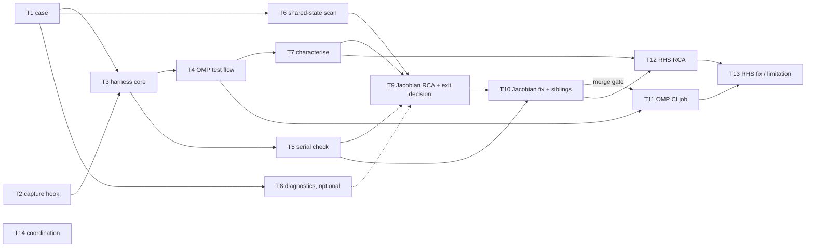

# Spec: AIUE-8 - Investigate non-deterministic OpenMP Jacobian behavior

> **Source of truth:** PRD [page 1540097](https://holm10uedge.atlassian.net/wiki/spaces/SD/pages/1540097)
> (adversarial review APPROVE round 3), copy at `docs/prds/AIUE-8-investigate-non-deterministic-openmp-jacobian.md`.
> **Jira epic:** [AIUE-8](https://holm10uedge.atlassian.net/browse/AIUE-8) · **Generated by:** `/spec AIUE-8` on 2026-10-14.
> Section references (§) point into the PRD. The round-3 MINORs (P3-m1 … P3-m4) are folded into the tickets named below.

## Epic summary

The OpenMP Jacobian (`OMPParallelJac=1`) disagrees with serial in the electron-energy rows and varies from run to run.
Reproduce it with the owner's case, explain it in an RCA, fix it so the OpenMP Jacobian, `sfscal` and `fnrm` sequence
are **bitwise equal to serial** at 2/4/8 threads in every fresh session, and guard it with an OpenMP CI job. Serial
results and every default stay bitwise unchanged. The OpenMP RHS (`OMPParallelPandf1=1`) is a bonus track.

## Tickets

Keys are the Jira issues filed under AIUE-8. Every product ticket gets its own branch and worktree with its own venv
(`.claude/context/branching.md`). AI-layer **code facts** (`CLAUDE.md`, `.claude/context/testing.md`,
`.claude/context/openmp-jacobian.md`) ship inside the ticket that changes the fact, with the `AI-layer: code-facts`
trailer; there is no separate docs ticket. No ticket needs an AI-layer **process** change (wiring the check into
`validate`/`code-review` is out of scope, §4).

Every ticket that touches Fortran, a `.v` file or `ppp/` attaches the §7.3 serial old-vs-new output to its PR once T5
exists (before that: the direct check written into T2).

| # | Key | Title | Track | Depends on | Wave |
|---|---|---|---|---|---|
| T1 | AIUE-46 | Commit the OpenMP reproducer case | Jac | — | 1 |
| T2 | AIUE-47 | Raw-Jacobian capture hook (off by default) | Jac | — | 1 |
| T14 | AIUE-48 | Coordinate with AIUE-9 and AIUE-21 (Task) | both | — | 1 |
| T3 | AIUE-49 | Harness core: fresh-process runner, capture, bitwise compare, localise | Jac | T1, T2 | 2 |
| T6 | AIUE-50 | Shared-state and `OmpCopy*` coverage scan | Jac | T1 | 2 |
| T8 | AIUE-51 | Optional OpenMP Jacobian diagnostics in `ppp/` | Jac | T1 | 2 |
| T4 | AIUE-52 | OpenMP test flow: configuration matrix, repeats, per-arm verdicts | Jac | T3 | 3 |
| T5 | AIUE-53 | Serial old-vs-new bitwise check | Jac | T3 | 3 |
| T7 | AIUE-54 | Characterise both arms and record pre-fix rates | Jac | T4 | 4 |
| T9 | AIUE-55 | Jacobian RCA and Phase 2 exit decision | Jac | T5, T6, T7 (T8 optional) | 5 |
| T10 | AIUE-56 | Fix the OpenMP Jacobian root cause(s) | Jac | T9, T5 | 6 |
| T11 | AIUE-57 | OpenMP CI job `build-test-omp.yml` | Jac | T4 (develop), T10 (merge) | 4 → 7 |
| T12 | AIUE-58 | RHS RCA (bonus) | RHS | T10, T7 | 8 |
| T13 | AIUE-59 | Fix the OpenMP RHS or document the known limitation (bonus) | RHS | T12, T11 | 9 |

Confluence view: [Spec: AIUE-8 - Investigate non-deterministic OpenMP Jacobian behavior - Ticket Breakdown](https://holm10uedge.atlassian.net/wiki/spaces/SD/pages/1835009)
(child of the PRD page).

### Phase 1: case, harness, characterisation

#### T1 — Commit the OpenMP reproducer case · `AIUE-46`
- **Scope (§7.1, §6.2):**
  - commit `input_mod4.py`, `gridue.hdf5`, `save_input_mod4.h5`, `mist.dat`, a trimmed `b0p1.hdf5`, the owner's
    `testscript*.py` and `comp*.sh` (reference only), and `tests/deterministic_omp/README.md`;
  - **do not commit** `to_tom/`, `testjac.hdf5`, `firstjac*`/`secondjac*`, `run*.txt`, `log.txt`, `*.swp`,
    `__pycache__/`, `.DS_Store`; add a `tests/deterministic_omp/.gitignore` for them;
  - trim `b0p1.hdf5` to the datasets the deck reads (`ngs`, `nis`, `phis`, `tes`, `tgs`, `tis`, `ups`, diffusivities);
    target ≤ 5 MB total, otherwise Git LFS or a size justification in the PR;
  - decide where the rate files `ehr2.dat` and `C_rates.adas` come from (environment variable plus a documented source,
    or a pinned download for CI), and remove every user-specific edit from the deck (`aphdir`/`apidir` via the chosen
    mechanism);
  - README: the case, required environment (`OMP_STACKSIZE=512M`, rate files, and for the gcc-15 C23 build failure
    either `CFLAGS=-std=gnu17` or `CC` set to Homebrew LLVM's clang, R6), and how to run the owner's scripts.
- **Acceptance:**
  - serial `yldot`, Jacobian (post-`exmain` `bbb.jac` with `ftol=1e20`) and `fnrm` with the trimmed data are bitwise
    equal to those with the original data (script output in the PR);
  - the case runs from a clean checkout with only the documented environment, in a `python -I` process with an empty `HOME`;
  - committed size reported in the PR.
- **Code facts:** `.claude/context/testing.md` line 3 ("There are no tests in this repository") and `CLAUDE.md` line 38
  become partly false; update both.
- **Files:** `tests/deterministic_omp/**`, `.claude/context/testing.md`, `CLAUDE.md`.
- **Depends on:** none.
- **Branch:** `feature/v9-AIUE-46-omp-reproducer-case` · base `v9-develop`.

#### T2 — Raw-Jacobian capture hook (off by default) · `AIUE-47`
- **Scope (§7.2 item 1, §7.5, P3-m1):** `jac_calc` cannot be called from Python, and `bbb.jac` after `exmain` is
  scaled by `1/suscal` and, after `psetnk`, row-normalised and RCM-permuted (§6.1). Add a capture point in
  `jac_calc_interface` (`bbb/oderhs.m:4670`), right after the `jac_calc`/`jac_calc_parallel` call, that copies the
  unscaled, unpermuted CSR Jacobian (`jac`, `ja`, `ia`, `nnz`) into capture arrays when a new switch is on. It must
  keep **every** Jacobian of a run (the `sfsetnk` one and each `psetnk` one), or the k-th one selected by index; the
  ticket picks the design and documents it. Review the existing `ppp` `EvalDumpJac` (`ppp/ppp.v:137`) for reuse.
  - Variables go in `bbb/bbb.v` (the `ppp` package depends on `bbb`, `Makefile.Forthon:31`), with units brackets and
    `#` descriptions. They are written by the master outside any parallel region, so they are **not** `+threadprivate`;
    say so in the description.
- **Acceptance:**
  - switch off (default): serial `yldot`, `bbb.jac` and the `fnrm` sequence are bitwise unchanged against `v9-develop`
    on the T1 case and on D_only, D+C and D_mols pytests inputs, in the `--serial` build and the OpenMP build with both
    switches 0 (a direct `float.hex`/SHA-256 comparison script in the PR; T5 re-confirms it later);
  - switch on: the captured serial Jacobian, multiplied back, equals the post-`exmain` `bbb.jac` for a `ftol=1e20` run;
    captures exist for both `jac_calc` and `jac_calc_parallel`;
  - MPPL hazards checked (`.claude/context/mppl-fortran.md`).
- **Code facts:** document the switch in `.claude/context/openmp-jacobian.md`.
- **Files:** `bbb/bbb.v`, `bbb/oderhs.m`, `.claude/context/openmp-jacobian.md`.
- **Depends on:** none.
- **Branch:** `feature/v9-AIUE-47-raw-jacobian-capture` · base `v9-develop`.

#### T3 — Harness core: fresh-process runner, capture, bitwise compare, localise · `AIUE-49`
- **Scope (§7.2 items 1, 2, 5, 6, 7; §6.6):** a Python library plus CLI under `tests/deterministic_omp/` (no `uetools`):
  - **runner:** one configuration per fresh `python -I` process with an empty `HOME`, in a temporary run directory
    holding the case files, case directory added to `sys.path` explicitly; pins and records `OMP_NUM_THREADS`,
    `ppp.Nthreads`, `OMP_STACKSIZE`;
  - **capture:** every Jacobian through the T2 hook, `sfscal`, the `fnrm` sequence over ≥ 3 Newton iterations (float64
    and the 16 printed `g26.16` digits), and on the RHS arm `yldot` of every measured parallel evaluation with a check
    that the parallel branch ran (`ijactot>0`, §6.1); the ticket states which Jacobians are compared (P3-m1);
  - **compare:** bitwise IEEE-754 (±0 different, any NaN/Inf fails), sparsity pattern included; an explicit ±0-equal
    mode for RHS-arm `yldot` only, because `REDUCTION(+)` turns serial `−0.0` into `+0.0`
    (`ppp/omp_parallel.F90:947-975`, P3-m2);
  - **localise:** map mismatching rows and columns through `igyl` and the `idx*` arrays (`bbb/bbb.v:2002-2008`) to
    (equation, species, `ix`, `iy`); report counts per equation pair and the first entries;
  - **record:** machine-readable JSON with provenance (commit, compiler and flags, `OMP_NUM_THREADS`, `Nthreads`,
    `OMP_STACKSIZE`, `OMPJacNchunks`, `OMPAutoBalance`, `OMPLoopJacNchunk`); exit codes 0 agree / 1 mismatch / 2 harness error;
  - diagnostic switches (`CheckJac`, `CheckPandf1`, `ForceSerialCheck`) are never on in a measured run.
- **Acceptance:**
  - two serial runs of the Te box compare equal (exit 0); serial vs OpenMP Te box at 4 threads exits 1 and names
    Te rows/columns (reproduces §6.3);
  - unit tests for the comparator (±0, NaN, Inf, pattern change) and the localiser;
  - a planted harness fault (missing case file) exits 2.
- **Code facts:** add the harness to `.claude/context/openmp-jacobian.md` (how to run, `OMP_STACKSIZE`).
- **Files:** `tests/deterministic_omp/harness/**` (name decided in the plan), its tests, README section,
  `.claude/context/openmp-jacobian.md`.
- **Depends on:** T1, T2.
- **Branch:** `feature/v9-AIUE-49-omp-harness-core` · base `v9-develop` after T1 and T2 merge (stack on the unmerged one otherwise).

#### T4 — OpenMP test flow: configuration matrix, repeats, per-arm verdicts · `AIUE-52`
- **Scope (§7.2 items 2–4, 6):** a driver over the T3 library:
  - configurations: owner's Te box; full problem; Te, Ti, ni, up, ng alone; a valid phi isolation (full problem with
    `isteon=0`, or phi with ni and up; phi alone fails in serial); each on the **Jacobian-only** and the
    **Jacobian + RHS** arm;
  - thread counts 2, 4, 8; a serial reference of the same build per configuration; K fresh-process repeats, K settable;
  - **separate verdicts per arm**, so CI can gate on one and report the other; one summary per run plus the JSON records;
  - user goal: "does OpenMP equal serial here, and where not?" in < 2 min on the Te box (§11).
- **Acceptance:** on `v9-develop` the Jacobian arm fails for the Te box and the full problem with localised Te
  mismatches; the Ti/ni/up/ng isolations pass (reproduces §6.3); the Te-box command finishes in < 2 min at 4 threads;
  the per-arm exit codes are tested.
- **Code facts:** test-flow usage in `.claude/context/openmp-jacobian.md` and the README.
- **Files:** `tests/deterministic_omp/**` (driver, config table), README, `.claude/context/openmp-jacobian.md`.
- **Depends on:** T3.
- **Branch:** `feature/v9-AIUE-52-omp-test-flow` · base `v9-develop` (after T3).

#### T5 — Serial old-vs-new bitwise check · `AIUE-53`
- **Scope (§7.3):** a tool that builds or takes two venvs (base `v9-develop` and the PR build), runs a case set
  **serially** in both, and compares bitwise with the T3 comparator: Jacobian at the T2 capture point, `yldot`, `sfscal`,
  `fnrm` sequence.
  - cases: the T4 configurations, and at least three coverage cases for shared `pandf` code (upstream `pytests` D_only,
    D+C, D_mols inputs; a double-null case if one is available; the AIUE-9 families once they exist);
  - both builds: `--serial`, and the default OpenMP build with `OMPParallelJac=OMPParallelPandf1=0`;
  - exit codes as T3.
- **Acceptance:** `v9-develop` against itself passes in both builds; a negative control (one perturbed coefficient in
  a scratch build) fails and names the case and first entry; documented as required for every PR touching Fortran,
  `.v` or `ppp/`.
- **Code facts:** the check in `.claude/context/openmp-jacobian.md` and `.claude/context/testing.md`.
- **Files:** `tests/deterministic_omp/**` (serial check tool), README, `.claude/context/{openmp-jacobian,testing}.md`.
- **Depends on:** T3.
- **Branch:** `feature/v9-AIUE-53-serial-bitwise-check` · base `v9-develop` (after T3). Parallel with T4.

#### T6 — Shared-state and `OmpCopy*` coverage scan · `AIUE-50`
- **Scope (§6.3 scan row, §12 Phase 2, H2/H3/H6):** extend the planning scan to what it did not cover:
  - scalars and integer arrays in `bbb`/`com`/`api`/`ppp` written during a local `pandf` (sentinel and before/after
    tests, on the Te box and the full problem);
  - `save`d locals and variables changed after `DATA` initialisation in routines reachable from `pandf` (known:
    `api/fmombal.m:70,368,1064`);
  - `ppp` module variables;
  - coverage of the `OmpCopy*` copy: every `+threadprivate` variable that is copied, and every one that is not;
  - automatic arrays read before written in `LocalJacBuilder` (`wk`, `yl_check`, `ppp/parallel.F90:195-196`, L2);
  - ThreadSanitizer run where the toolchain allows it (local only).
- **Acceptance:** a findings table (variable, file:line, kind, written where, threadprivate yes/no, copied yes/no) in
  `docs/rca/AIUE-8-omp-jacobian-nondeterminism.md` §Shared-state scan; scan scripts committed under
  `tests/deterministic_omp/tools/` and re-runnable; no product code changes.
- **Files:** `tests/deterministic_omp/tools/**`, `docs/rca/AIUE-8-omp-jacobian-nondeterminism.md`.
- **Depends on:** T1.
- **Branch:** `feature/v9-AIUE-50-shared-state-scan` · base `v9-develop` (after T1). Parallel with T3.

#### T8 — Optional OpenMP Jacobian diagnostics in `ppp/` · `AIUE-51`
- **Scope (§7.5):** only what T6/T9 need; candidates:
  - a repeat-and-compare Jacobian check;
  - a deterministic amplifier: a second evaluation under a fixed, different column-to-thread assignment;
  - richer `CheckJac`/`ForceSerialCheck` mismatch reports (all mismatches with equation/cell, not abort on the first).
  - constraints: off by default; units bracket and `#` description in `ppp/ppp.v`; existing pass/fail rules unchanged; §9 applies.
- **Acceptance:** each switch off reproduces `v9-develop` bitwise (OpenMP build, both switches 0 and 1 with
  diagnostics off); each switch on is demonstrated on the Te box; the switches are documented.
- **Code facts:** switches in `.claude/context/openmp-jacobian.md`.
- **Files:** `ppp/ppp.v`, `ppp/parallel.F90`, `ppp/omp_parallel.F90`, `ppp/debug_parallel.F90`, `.claude/context/openmp-jacobian.md`.
- **Depends on:** T1. **Optional:** close as Won't Do if T9 does not need it.
- **Branch:** `feature/v9-AIUE-51-omp-diagnostics` · base `v9-develop`.

#### T7 — Characterise both arms and record pre-fix rates · `AIUE-54`
- **Scope (§7.2, §11, §12 Phase 1):** run the T4 flow on `v9-develop` for every configuration, both arms, 2/4/8
  threads, on Linux and macOS (R4). Record the pre-fix rates **at 4 threads** (P3-m4): full problem disagrees with serial
  in 20/20 runs, Te box non-deterministic in ≥ 19/20. Answer the open questions on Ti and phi. Characterise the RHS arm
  too, so the bonus track starts from data. Measure the run times that T11's budget needs.
- **Acceptance:** `docs/rca/AIUE-8-omp-jacobian-nondeterminism.md` has the characterisation tables (per configuration,
  arm, thread count, platform) with the JSON records attached or referenced; the §6.3 observations are confirmed or
  corrected explicitly; timing table for CI.
- **Files:** `docs/rca/AIUE-8-omp-jacobian-nondeterminism.md` (artifact only).
- **Depends on:** T4.
- **Branch:** `feature/v9-AIUE-54-omp-characterisation` · base `v9-develop` (after T4; rebase over T6 on the RCA file).

### Phase 2: Jacobian root cause

#### T9 — Jacobian RCA and Phase 2 exit decision · `AIUE-55`
- **Scope (§7.4, §12 Phase 2):**
  - test H1–H4, H6 and L1–L3 on the Jacobian-only arm with minimal experiments (scratch branches, not merged), using
    the T6 findings and T8 diagnostics as needed;
  - **P3-m3:** check that the serial Te Jacobian is independent of column order (a different order gives the same bits)
    before deciding the gate;
  - RCA Jacobian section: per root cause the variable/routine with file:line, mechanism, evidence, proposed fix and its
    effect on serial; refuted hypotheses;
  - **exit decision with the owner (decision 9):** bitwise equality reachable for every configuration, or the fallback
    gate for named configurations; the fallback tolerance is based on finite-difference noise (`del=1e-8`) or on the
    serial spread under a benign history change, never on the spread of bitwise configurations (P3-m4);
  - escalate §9(a) cases (fix would move serial) to the owner;
  - **file one fix ticket per independent root cause** under AIUE-8 (T10 takes the first; siblings are created here).
- **Acceptance:** for each root cause a minimal experiment removes the mismatch; serial impact stated per fix; owner's
  exit decision recorded in the RCA; fix tickets filed.
- **Files:** `docs/rca/AIUE-8-omp-jacobian-nondeterminism.md`.
- **Depends on:** T5, T6, T7 (T8 optional).
- **Branch:** `feature/v9-AIUE-55-omp-jacobian-rca` · base `v9-develop`.

### Phase 3: Jacobian fix

#### T10 — Fix the OpenMP Jacobian root cause(s) · `AIUE-56`
- **Scope (§9, §11, §12 Phase 3):** implement the fix for the first root cause named in T9 (siblings take the others;
  if there is only one cause, this ticket carries the full Jacobian-track acceptance). Allowed: `+threadprivate`
  markers, per-thread resets, `OmpCopy*` coverage, chunk construction, uninitialised-array fixes, in the `pandf` tree,
  `ppp/` or the `.v` files. Not allowed: default changes, stencil widening, `xlinc`/`xrinc`/`yinc` changes. Measure
  OpenMP Jacobian time before/after; report a slowdown > 10 % to the owner.
- **Acceptance (the last fix ticket to merge carries the full set):**
  - T4 flow, Jacobian arm: **0 mismatches in 30/30** fresh-session runs of the Te box and the full problem at 4 threads;
    0/5 at 2 and 8 threads; 0/5 for each other configuration at 4 threads; on Linux and macOS (or the fallback gate the
    owner chose in T9 for named configurations);
  - Ti/ni/up/ng isolations still bitwise equal to serial;
  - T5 serial check passes bitwise in both builds; output in the PR;
  - OpenMP-build `pytests` suites still pass.
- **Code facts:** new `+threadprivate` or copy rules in `.claude/context/openmp-jacobian.md`.
- **Files (estimate):** `bbb/bbb.v`, `api/api.v`, `com/com.v`, `bbb/pandf_plasma_energy.m`, `bbb/pandf*.m`, `api/*.m`,
  `ppp/*.F90`, `.claude/context/openmp-jacobian.md`. Conflicts with sibling fix tickets on `.v` files are likely: land
  them one by one and rebase.
- **Depends on:** T9, T5.
- **Branch:** `bugfix/v9-AIUE-56-omp-jacobian-fix` · base `v9-develop`.

### Phase 4: CI guard

#### T11 — OpenMP CI job `build-test-omp.yml` · `AIUE-57`
- **Scope (§7.6):** new workflow, push and pull_request; `ubuntu-latest`, Python 3.11, `numpy==1.26.4`, `h5py`;
  rate files as T1 decided; `pip install -v .` (default OpenMP build); smoke test; T4 flow on the Te box and the full
  problem at 2 and 4 threads, ≥ 3 Newton iterations, serial reference per configuration; artifacts uploaded. Jacobian
  arm **gates**, RHS arm is **report-only**. Budget ≤ 20 min, repeat counts set from T7's timings; if over budget, a
  nightly full matrix plus a reduced PR set (R5). Final README section on CI.
- **Acceptance:**
  - red on the pre-fix code in 20/20 runs, and on a seeded race (remove `+threadprivate` from a variable written in
    the electron-energy path) in 20/20 runs; green on the fixed code;
  - a failure names the configuration, arm, equation and cell of the first mismatch;
  - measured wall time in the PR; `check_context_refs.py --changed origin/v9-develop` clean.
- **Code facts:** `.claude/context/testing.md` line 48 ("OpenMP paths are not tested in CI") and the CI list;
  `.claude/context/openmp-jacobian.md`.
- **Files:** `.github/workflows/build-test-omp.yml`, `tests/deterministic_omp/README.md`, `.claude/context/{testing,openmp-jacobian}.md`.
- **Depends on:** T4 to develop (the red runs need the pre-fix code); **merges with or after the last Jacobian fix
  ticket** (T10 and siblings).
- **Branch:** `feature/v9-AIUE-57-omp-ci-job` · base `v9-develop`; rebase after T10 merges.

### Phase 5: Jacobian + RHS (bonus, does not gate the epic)

#### T12 — RHS RCA · `AIUE-58`
- **Scope (§7.4, §12 Phase 5, R-H):** root-cause the RHS arm from the T7 data: chunk decomposition with non-local
  boundary conditions (`iflcore=1`, `isnicore=3` core ring sums), the `auxrange` widening
  (`ppp/omp_parallel.F90:1015-1030`), edge-only `bouncon` (`:1093-1105`), per-thread state without a master refresh,
  the 15th-digit `fnrm` variation; signed zeros from `REDUCTION(+)` are listed and excluded (P3-m2).
  Decide with the owner: fix, or known limitation.
- **Acceptance:** RCA RHS section with root causes or a known-limitation statement with evidence; owner decision recorded.
- **Files:** `docs/rca/AIUE-8-omp-jacobian-nondeterminism.md`.
- **Depends on:** T10 (Jacobian track first, decision 8), T7.
- **Branch:** `feature/v9-AIUE-58-omp-rhs-rca` · base `v9-develop`.

#### T13 — Fix the OpenMP RHS or document the known limitation · `AIUE-59`
- **Scope (§4, §10, §11 bonus):** either fix under §9 and switch the CI RHS arm to gating, or document where
  `OMPParallelPandf1` is unsafe in the RCA, `.claude/context/openmp-jacobian.md` and the `OMPParallelPandf1`
  description in `ppp/ppp.v`, leaving the CI arm report-only. A warning or block is an owner decision.
- **Acceptance:** if fixed, the T10 acceptance sizes with `OMPParallelPandf1=1` and the CI RHS arm gating; if not, the
  limitation is documented; T5 passes either way.
- **Files (estimate):** `ppp/omp_parallel.F90`, `ppp/ppp.v`, `bbb/pandf_boundary.m`, `.github/workflows/build-test-omp.yml`,
  `.claude/context/openmp-jacobian.md`, the RCA.
- **Depends on:** T12, T11.
- **Branch:** `bugfix/v9-AIUE-59-omp-rhs-fix` · base `v9-develop`.

### Coordination

#### T14 — Coordinate with AIUE-9 and AIUE-21 · `AIUE-48` (Task)
- **Scope (§13):**
  - owner mirrors the §13 agreements in the AIUE-9 PRD (lines ~191, ~662-667, ~697): AIUE-8 owns the explanation of the
    run-to-run randomness; AIUE-9's `tests/tools/omp_check.py` wraps the AIUE-8 flow or is dropped; one AI-layer PR
    replaces `validate` §4; the AIUE-8 flow sets its own `OMP_NUM_THREADS`; if AIUE-9's `tests/` reference guard lands
    first, `tests/deterministic_omp/` PRs carry `Test criteria: changed` or the directory is listed as unguarded;
  - **AIUE-21** (AIUE-5 T5, "OpenMP determinism regression case") requires bit-identical repeats with
    `ParallelJac=1`, `ParallelPandf1=1` and `ParallelMatfac=1`. It will hit this bug, and `ParallelMatfac` is out of
    scope here. Agree with the AIUE-5 owner: link AIUE-21 as blocked by T10 (and T13 for the RHS), or reuse the T4 flow.
- **Acceptance:** AIUE-9 PRD updated; Jira links between AIUE-21 and T10/T13 recorded; decisions noted on AIUE-8.
- **Files:** none in this epic (AIUE-9 planning branch is the owner's).
- **Depends on:** none.
- **Branch:** none.

## Dependency graph

## Suggested execution order

| Wave | Tickets | Notes |
|---|---|---|
| 1 (parallel) | T1, T2, T14 | Disjoint files: `tests/` vs `bbb/`. T1 and T2 both touch AI-layer context files (different lines) |
| 2 (parallel) | T3, T6, T8 | T3 needs T1+T2; T6 and T8 need only T1. T6 creates the RCA file |
| 3 (parallel) | T4, T5 | Both build on the T3 library; separate modules, shared README (rebase) |
| 4 | T7; start T11 | T7 rebases over T6 on the RCA file. T11 can be developed now and shown red on pre-fix code |
| 5 | T9 | Owner exit decision; files sibling fix tickets |
| 6 | T10 (+ siblings, one by one) | `.v` conflicts between fix tickets: serial merge |
| 7 | T11 merges | With or after the last Jacobian fix — closes the gating track |
| 8 | T12 | Bonus |
| 9 | T13 | Bonus |

Critical path: T2 → T3 → T4 → T7 → T9 → T10 → T11.

## Integration

Ticket PRs target **`v9-develop`** one by one. No epic integration branch: every ticket is independently buildable and
leaves serial results bitwise unchanged (§9). The only ordering constraint on `v9-develop` is that T11 must not merge
before the Jacobian fix, or `v9-develop` CI goes red.

## Changes from the PRD and open points

1. **The raw-Jacobian capture hook is its own ticket (T2) and lives in `bbb`, not `ppp`.** P3-m1 requires a §7.5 hook
   because `jac_calc` isn't callable from Python. The single point that sees both serial and parallel Jacobians is
   `jac_calc_interface` (`bbb/oderhs.m:4670`), and `ppp` depends on `bbb`, so the switch goes in `bbb/bbb.v`. This touches
   the serial code path (off by default). T5 doesn't exist yet, so T2 carries its own bitwise check.
2. **The shared-state scan (T6) is pulled out of Phase 2** so it can start right after the case lands.
3. **Phase 3 is one filed ticket (T10).** The PRD asks for one ticket per independent root cause, which is unknown until
   T9. T9 files the siblings.
4. **No Phase 4 docs ticket.** AI-layer code facts ship with the ticket that changes them (`branching.md`): T1 (testing.md
   line 3, CLAUDE.md line 38), T2/T3/T4/T5/T8/T10 (openmp-jacobian.md), T11 (testing.md line 48).
5. **AIUE-21 overlap** (AIUE-5 epic) is handled in T14, not duplicated here.
6. **gcc-15 C23 failure in `bbb/exmain.c` (R6)** is not filed under this epic (§13 says its own bug ticket). Two workarounds
   are known and documented in T1: `CFLAGS=-std=gnu17`, or building the C sources with Homebrew LLVM's clang as `CC`
   (owner, 2026-10-15).
